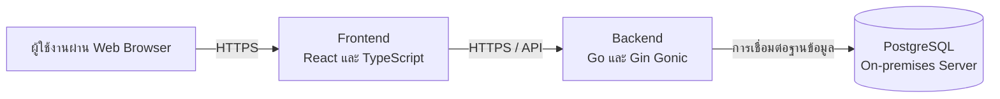
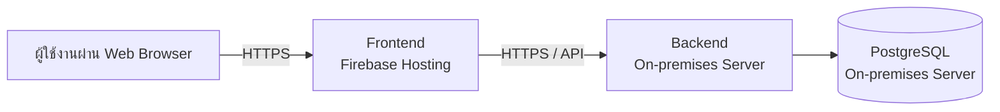

# ข้อมูลทางเทคนิคของเว็บไซต์คณะกรรมการนิสิตอักษรศาสตร์ (ก.อศ.)

เรียน อ.จักรพันธ์

รายละเอียดทางเทคนิคโดยสรุปของเว็บไซต์คณะกรรมการนิสิตอักษรศาสตร์ (ก.อศ.) มีดังนี้

## 1. สถาปัตยกรรมของระบบ (System Architecture)

เว็บไซต์ใช้สถาปัตยกรรมแบบแยกส่วนระหว่าง Frontend, Backend และ Database โดยแต่ละส่วนมีหน้าที่ดังนี้

- **Frontend (Web Application):** ส่วนติดต่อผู้ใช้งาน ทำหน้าที่แสดงผลข้อมูลและรับคำสั่งจากผู้ใช้งานผ่านเว็บเบราว์เซอร์
- **Backend (API Server):** ทำหน้าที่ประมวลผลคำขอจาก Frontend จัดการตรรกะของระบบ และติดต่อกับฐานข้อมูล
- **Database:** ใช้จัดเก็บข้อมูลของระบบ โดยเป็น PostgreSQL ซึ่งทำงานอยู่บนเซิร์ฟเวอร์ภายในองค์กร (On-premises Server)

การติดต่อระหว่าง Frontend และ Backend ใช้ API ผ่านเครือข่าย HTTPS และ Backend เป็นส่วนที่เชื่อมต่อกับฐานข้อมูลโดยตรง ดังแผนภาพต่อไปนี้

## 2. องค์ประกอบและการเชื่อมต่อของระบบ

องค์ประกอบหลักของระบบประกอบด้วย

1. **Frontend Application**
   - พัฒนาด้วย React และ TypeScript
   - ทำหน้าที่แสดงหน้าเว็บไซต์และติดต่อกับ Backend ผ่าน API
   - Prototype ปัจจุบันให้บริการผ่าน Firebase Hosting

2. **Backend API**
   - พัฒนาด้วยภาษา Go โดยใช้ Gin Gonic Framework
   - ทำหน้าที่รับและประมวลผลคำขอจาก Frontend
   - ทำหน้าที่อ่านและบันทึกข้อมูลผ่านฐานข้อมูล PostgreSQL
   - Prototype ปัจจุบันทำงานบน Google Cloud Run

3. **Database**
   - ใช้ PostgreSQL
   - ฐานข้อมูลทำงานอยู่บน On-premises Server
   - การเชื่อมต่อจากภายนอกมายังฐานข้อมูลดำเนินการผ่าน Backend เท่านั้น โดย Frontend ไม่เชื่อมต่อฐานข้อมูลโดยตรง

การเชื่อมต่อหลักของระบบในปัจจุบัน ได้แก่

- ผู้ใช้งานเชื่อมต่อกับ Frontend ผ่านเว็บเบราว์เซอร์
- Frontend เชื่อมต่อกับ Backend ผ่าน API
- Backend เชื่อมต่อกับ PostgreSQL บน On-premises Server
- Firebase Hosting ใช้สำหรับให้บริการ Frontend
- Google Cloud Run ใช้สำหรับให้บริการ Backend ในระยะ Prototype

## 3. ภาษาและเทคโนโลยีที่ใช้

| ส่วนของระบบ | ภาษา/เทคโนโลยี |
| --- | --- |
| Frontend | TypeScript, React |
| Backend | Go, Gin Gonic |
| Database | PostgreSQL |
| Frontend Hosting | Firebase Hosting |
| Backend Hosting (Prototype) | Google Cloud Run |

## 4. สถานที่ Deploy Prototype และแผนในอนาคต

ปัจจุบันมีการ Deploy ระบบ Prototype แล้ว โดยมีรายละเอียดดังนี้

- **Frontend:** Deploy บน Firebase Hosting
- **Backend:** Deploy บน Google Cloud Run
- **Database:** PostgreSQL บน On-premises Server

สำหรับ Backend ปัจจุบันทีมกำลังวางแผนย้ายจาก Google Cloud Run มาทำงานบน On-premises Server เพื่อเพิ่มประสิทธิภาพด้านค่าใช้จ่าย (Cost Optimization) โดยสถาปัตยกรรมหลังการย้ายที่วางแผนไว้จะเป็นดังนี้

> **หมายเหตุ:** รายละเอียดข้างต้นเป็นภาพรวมของระบบ ณ ระยะ Prototype และอาจมีการปรับเปลี่ยนตามข้อกำหนดด้านโครงสร้างพื้นฐาน ความปลอดภัย และการดูแลระบบของคณะในอนาคต
